<div align="center">


<br>


# Commutr

**A little greener, every journey.**

🏆 **2nd place at the hackathon.**

Earn points for walking, cycling and taking transit around Kitchener-Waterloo,<br>
and talk to Muta, a voice mascot that moves the app for you.

### [▶ Try it live: commutr-psi.vercel.app](https://commutr-psi.vercel.app)

<sub>Mobile first: best on a phone. The first load after a quiet spell can take a few seconds while the free backend wakes up.</sub>

<br>

[](https://commutr-psi.vercel.app)


<br>

<table>
  <tr>
    <td align="center" width="25%">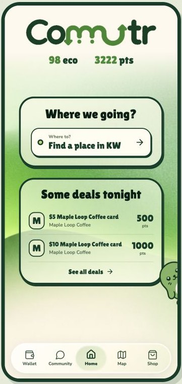</td>
    <td align="center" width="25%">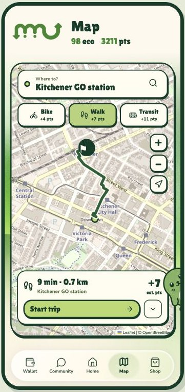</td>
    <td align="center" width="25%">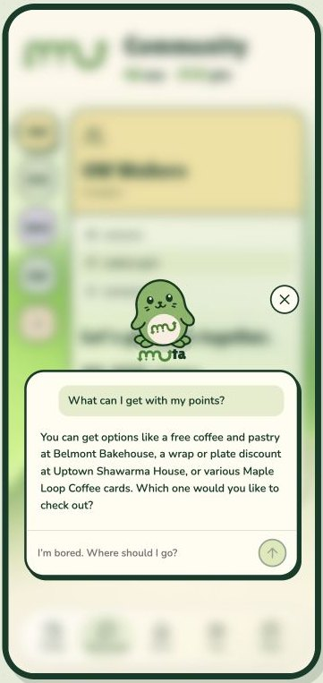</td>
    <td align="center" width="25%">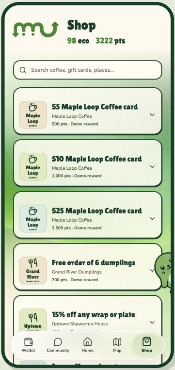</td>
  </tr>
  <tr>
    <td align="center"><sub><b>Home</b><br>Eco score, points and deals</sub></td>
    <td align="center"><sub><b>Map</b><br>Walk route with minutes, km and points</sub></td>
    <td align="center"><sub><b>Muta</b><br>Ask about your points and rewards</sub></td>
    <td align="center"><sub><b>Shop</b><br>Rewards gated by eco score</sub></td>
  </tr>
</table>

</div>

> [!NOTE]
> **All merchants, rewards, users and clubs are demo data.** Commutr has no real sponsor, partner or government affiliation.

## What it is

Commutr is a mobile-first web app (an installable PWA) for Kitchener-Waterloo that rewards people for replacing car trips with walking, cycling, scooting or transit. You pick a mode and record a trip, the backend verifies it from GPS, and you earn points to spend on eco-gated rewards at local businesses (demo merchants in this build). Streaks, clubs and an eco score make it a habit.

**Muta**, the app's mascot, can be typed to or talked to. It answers questions about your account, finds real places, plans trips onto the map, starts and finishes trips and redeems rewards, all through the same code paths your taps use.

Gemini powers trip planning, text chat and route safety ratings. ElevenLabs powers Muta’s live, two-way voice conversations and in-app voice actions.

## 🗺️ Tour of the app

<table>
  <tr>
    <td align="center" width="25%">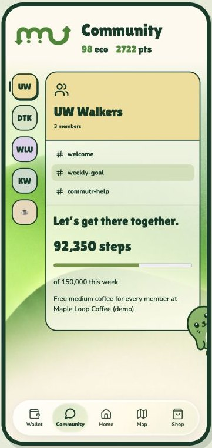</td>
    <td align="center" width="25%">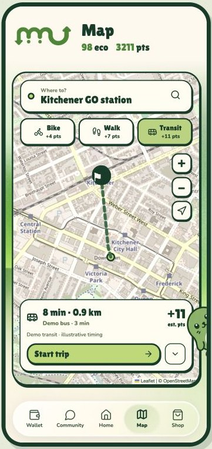</td>
    <td align="center" width="25%">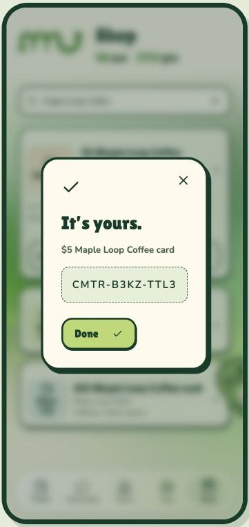</td>
    <td align="center" width="25%">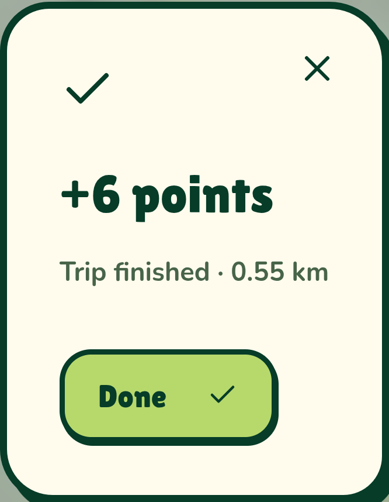</td>
  </tr>
  <tr>
    <td align="center"><sub><b>Community</b><br>A club's shared weekly step goal</sub></td>
    <td align="center"><sub><b>Transit option</b><br>Suggested destination, illustrative demo timing</sub></td>
    <td align="center"><sub><b>Redeem</b><br>A demo reward and its code</sub></td>
    <td align="center"><sub><b>Demo walk</b><br>The GPS track was simulated to show the real scoring result. Not a real outdoor walk.</sub></td>
  </tr>
  <tr>
    <td align="center">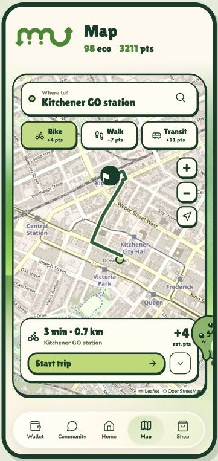</td>
    <td align="center">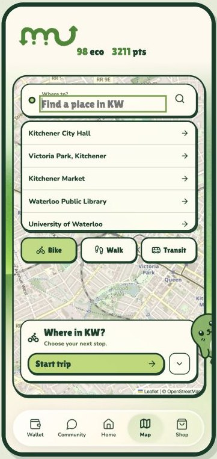</td>
    <td align="center">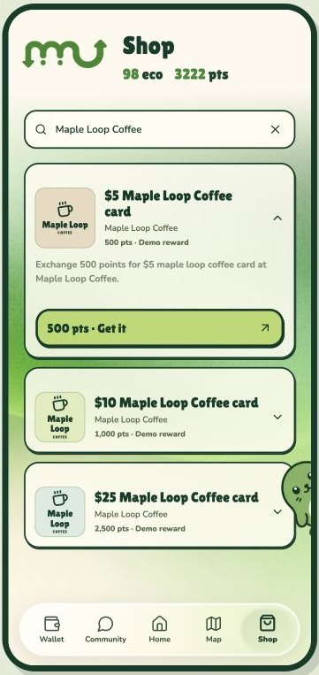</td>
    <td align="center">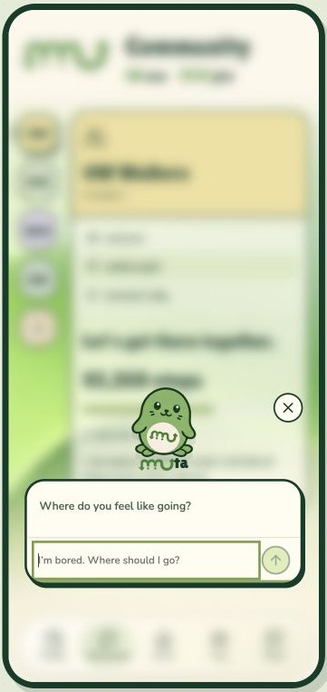</td>
  </tr>
  <tr>
    <td align="center"><sub><b>Bike</b><br>Same trip, by bike</sub></td>
    <td align="center"><sub><b>Search</b><br>Find a place in KW</sub></td>
    <td align="center"><sub><b>Offer</b><br>A demo reward up close</sub></td>
    <td align="center"><sub><b>Muta</b><br>Type or talk</sub></td>
  </tr>
</table>

## Features

- **Map and trips:** search KW places, compare walk, bike and transit with minutes, km and estimated points, then start, record and finish a trip. GPS records while the app is open in the foreground.
- **Live GRT transit:** real Grand River Transit bus and ION positions and next arrivals (details below).
- **Shop:** demo rewards gated by eco score as well as points, with a redemption code on redeem.
- **Wallet:** eco score, points, redeemed codes and recent trips.
- **Community:** clubs with a shared weekly step goal, and a help chat.
- **Muta:** type ("Let's type") or talk ("Let's talk"), as described above.
- **Route safety:** ask Muta about one of the 4 rated demo routes and the rating card shows on the map.
- **Photo trip (no GPS):** a browser-only rehearsal mode. The photo isn't uploaded, and its points stay in that browser: they don't change server balances or what you can redeem.
- **Installable PWA**, mobile first.

## 🤝 Why it works for everyone

> **This section describes the design of the system, not built features or measured results.**

- **People:** verified green trips earn points for eco-gated rewards (demo rewards in this build), with streaks and clubs to keep the habit going.
- **Businesses:** rewards give people a reason to walk or ride to a local place. The merchants in this build are fictional demo data, not partners.
- **Government and transit agencies:** the aim is fewer car trips, and the app uses real GRT open data for live buses and transit checks. There is no government partnership, no government dashboard and no measured impact.

## How scoring works

```
points = verified_km × mode_rate × confidence × trust_multiplier   (rounded, max 200 per day, Toronto date)
```

| Mode | Points per verified km |
|---|---|
| Walk | 10 |
| Bike | 6 |
| Scooter | 4 |
| Transit | 12 |
| Car | 0 (allowed, lowers the eco score) |

You pick the mode before the trip. While the app is open it uploads GPS points, and the backend scores the trip when you finish. All values are in [`backend/src/scoring/config.ts`](backend/src/scoring/config.ts).

- **Verified km:** points with accuracy worse than 50 m are dropped, movements under 10 m count as GPS jitter, and impossible jumps or stretches faster than the mode allows don't count.
- **Sparse GPS is fine.** Browsers pause GPS in the background, so a gap alone never lowers confidence.

### Anti-cheat: confidence checks

Confidence starts at 1.0 and each failed check subtracts from it (floor 0):

| Check | Rule | Penalty |
|---|---|---|
| Speed too high | Average moving speed above the mode's limit (walk 12, bike 30, scooter 28, transit 70 km/h) | −0.5 |
| Car-like burst | Any 60 s window above 20 / 45 / 40 km/h on a walk / bike / scooter trip | −0.6 |
| Impossible jump | A jump of at least 500 m faster than 25 / 70 / 60 / 130 km/h (walk / bike / scooter / transit) | −0.5 |
| Too few points | Fewer than 5 usable points | −0.5 |
| Poor accuracy | Over half the points dropped, or median accuracy worse than 30 m | −0.2 |
| Constant speed | Speed varies less than 5% over 10 or more segments (looks simulated) | −0.5 |
| Far from last trip | Starts over 2 km from where the previous trip ended less than 60 min ago | −0.2 |
| Transit start / end | A transit trip starting or ending more than 200 m from a GRT stop | −0.4 each |

- **Trust multiplier** (per user, 0.4 to 1.0): a trip with confidence below **0.3** earns 0 points and lowers trust by 0.15. Each clean trip (confidence ≥ 0.8, ≥ 0.5 km) adds 0.02 back.
- **Eco score** (0 to 100): car trips cost 0.5 per km (min 1, max 10 per trip). Green trips of at least 1 km add 1, up to 3 a day. A low-confidence trip doesn't count as a car trip.
- **Rewards are gated by eco score as well as points.** For example, the demo Maple Loop Coffee $5, $10 and $25 cards need eco 80, 85 and 95, and stay locked below that even with enough points.
- **Streaks:** one green trip of at least 0.5 km per day. **Clubs:** weekly shared step goals, from walk km × 1,300.

## Live GRT transit data

The backend reads the real Grand River Transit feeds from the Region of Waterloo open data API: GTFS-realtime vehicle positions and trip updates for buses (feed 1) and ION light rail (feed 2), plus the static GTFS schedule and stops. It parses the protobuf and serves plain JSON. Live buses show on the map, the trip planner uses the next live departure, and transit trips are checked against real stop locations. If a feed fails, it falls back to clearly marked fake bus data. On the Map screen, the transit option for the 6 suggested destinations is labelled demo data ("Demo transit · illustrative timing"), not a live timetable.

## Architecture

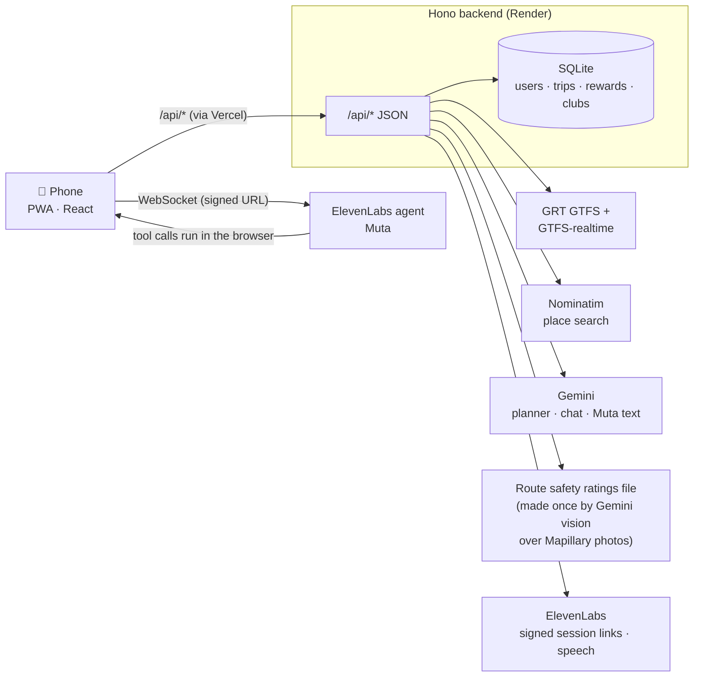

The browser never holds a provider key. The ElevenLabs agent is private: the backend hands the browser a short-lived signed link.

**Stack:** Node 22+, TypeScript, Hono, SQLite (better-sqlite3), `@google/genai`, `gtfs-realtime-bindings` · React 18, Vite 6, vite-plugin-pwa, Leaflet with OpenStreetMap tiles, walk and bike route lines from Valhalla, `@elevenlabs/client`.

## Run it locally

```sh
npm run setup                          # installs backend and frontend packages
cp backend/.env.example backend/.env   # then fill in GEMINI_API_KEY and ELEVENLABS_API_KEY
```

Then follow [`docs/local-phone-run.md`](docs/local-phone-run.md): start the backend and frontend, check them, and open the app on a phone through an HTTPS tunnel (phones need HTTPS for GPS and the microphone).

`npm test` runs the mocked test suites, with no real provider calls.

## Deployment

- **Frontend:** Vercel, https://commutr-psi.vercel.app. [`frontend/vercel.json`](frontend/vercel.json) forwards `/api` to the backend; see [`frontend/DEPLOYMENT.md`](frontend/DEPLOYMENT.md).
- **Backend:** Render, https://commutr-backend.onrender.com (free tier: the first request after idle can be slow).

## Docs

- [`docs/api.md`](docs/api.md): the API contract between frontend and backend
- [`docs/local-phone-run.md`](docs/local-phone-run.md): run locally and open on a phone
- [`docs/agent-tools.md`](docs/agent-tools.md): Muta's browser tools
- [`docs/elevenlabs-agent-setup.md`](docs/elevenlabs-agent-setup.md): the ElevenLabs agent and the frontend voice integration (section 7)
- [`COMPANION.md`](COMPANION.md): Muta's design notes

## Team

- Backend (API, scoring, transit, planner, chat): Shahmeer
- Frontend (UI, map, PWA, Muta interface): kostslava

## Attribution

- Transit data: Grand River Transit, Region of Waterloo Open Data
- Map tiles and place search: © OpenStreetMap contributors (Nominatim)
- Route lines: Valhalla (public server at valhalla1.openstreetmap.de)
- Street imagery for route safety: Mapillary contributors, CC BY-SA 4.0 (photo creators are listed with each rating)
- Voice: ElevenLabs. AI: Google Gemini
- Merchants, rewards, users and clubs are demo data
